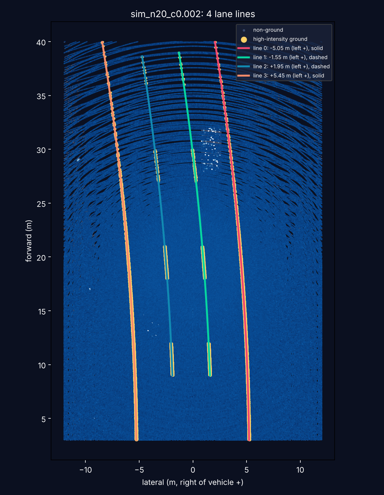
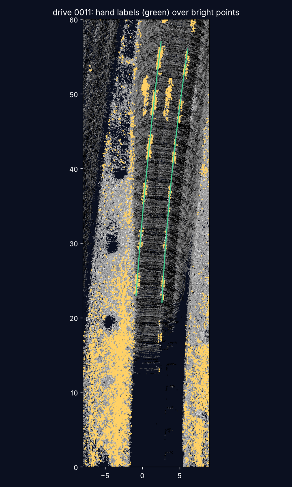

# LiDAR lane-marking extraction

Turning raw LiDAR road scans into lane-line geometry, the first step of an HD map.

Lane paint is retroreflective, so it returns noticeably higher intensity than asphalt.
This pipeline finds the road surface, picks out paint by intensity, and fits lane lines.
It uses classical geometry and no neural network, so every step can be inspected.

**Real data: KITTI raw drive `2011_09_26_drive_0001`, 40 stitched scans (~4.5M points)**


**Simulated 3-lane road with known ground truth**



## Pipeline

1. **Stitch scans** (`accumulate.py`): a single scan is too sparse along the road, so consecutive scans are merged into one local map using the GPS/IMU poses.
2. **Ground plane**: RANSAC restricted to near-horizontal planes, then a least-squares refit on the inliers.
3. **Paint candidates**: a range-adaptive intensity threshold (median + k·MAD per 2 m range bin).
4. **Structure filter**: drops bright ground points that have a pole, kerb or vehicle directly above them.
5. **Anisotropic DBSCAN**: the x axis is compressed 4×, so paint hits on successive LiDAR rings chain into one segment. The step keeps elongated, longitudinal clusters.
6. **Lane chaining**: each segment joins the lane whose extrapolated trajectory passes closest to it.
7. **Fragment merging**: pieces of the same line that sit end to end and agree laterally are joined.
8. **Rail detection**: parallel pairs 1.435 m apart (or two ridges inside one wide band) are labelled as rails.
9. **Quality filter**: drops lines with a fit residual above 0.15 m (kerbs, rails, gravel) or shorter than 8 m.
10. **Fit and classify**: a polynomial y = f(x) per line. Solid vs dashed comes from paint coverage along the line.

## Results

### Real data (KITTI drive 0001, urban road beside tram tracks)

- Recovers the **dashed centre line** (about 51 m long, 4.8 cm fit residual) and a **solid line** 3.05 m away (8.6 cm residual), which is a typical urban lane width.
- **Failure mode found and fixed:** tram rails reflect as brightly as paint, so the first version reported 12 "lanes". A residual-based quality filter removes noisy kerb and gravel lines, and a geometry prior identifies rails: parallel pairs one track gauge (1.435 m) apart. On drive 0001 it found a **double tram track: two rail pairs measured 1.42 m and 1.46 m apart**, now labelled as rails instead of lanes.
- **Road alignment:** the map is rotated to the road heading measured from the paint near the vehicle (correction on drive 0001: -0.55 deg; the remaining lean in the plot is the road genuinely curving).
- Tuning: `--k-mad 2.5`. A stricter threshold (3.0) fragmented real lines; a looser one (2.0) let in kerbs and pavement.

### Simulation (64-beam LiDAR, 3-lane road, known geometry)

| Setup | Lines found | False positives | Mean lateral error |
|---|---|---|---|
| Single scan, gentle curve | 2/4 | 0 | ~2 cm (dashed lines missed) |
| 20 stitched scans, straight | **4/4** | 0 | < 1 cm |
| 20 stitched scans, gentle curve (R≈250 m) | **4/4** | 0 | < 1 cm |
| 20 stitched scans, tight curve (R≈125 m) | **4/4** | 0 | < 1 cm |

**Key finding:** a single scan misses dashed lines because beam rings are too sparse along the road. Stitching scans recovers them, which is why mapping pipelines accumulate before extracting lanes.

**Caveat:** simulated errors are optimistic because the simulation has perfect poses. On real data, pose drift and LiDAR–IMU calibration error dominate.

## Machine learning: does it transfer to a new street?

The rules above were tuned on one drive. To test whether anything generalises, `train_classifier.py` trains a
gradient-boosted classifier (paint vs not-paint) on the bright ground points of drive 0001 and tests it on
**drive 0011, a different street it never saw**.

- **Training labels are weak:** they come from the rule pipeline (near a kept lane line = paint, far from every line = not paint).
- **Features have physical reasons behind them:** intensity relative to the local road, height above the road plane (rail heads sit higher), surface roughness (gravel beds are rough), how line-like and road-aligned the nearby bright points are, and a rail-pair score (another bright line one track gauge away).
- **The split is spatial:** every 4th 5 m block of road is held out, so test points never sit right next to training points.
- **The test labels on drive 0011 are independent:** the two dashed lane lines were drawn by eye from the dash positions in the top-down view (`data/drive0011_gt.json`, check image below), not by the rules.

| Test | ROC AUC | Paint precision | Paint recall | Not-paint recall |
|---|---|---|---|---|
| Drive 0001, held-out road (labels from the rules) | 0.997 | 0.99 | 0.90 | 1.00 |
| **Drive 0011, unseen street (hand labels)** | **0.878** | **0.83** | **0.23** | **1.00** |
| Rule pipeline on drive 0011 | found **0 of 2** lane lines | | | |

**What this shows:**
- The 0.997 on drive 0001 is inflated. The labels come from the rules, and the top feature (how line-like the bright points are) is close to what the rules check, so the model is partly learning to copy them. That is why the test on a second street with independent labels matters.
- On the new street, the hand-tuned rules find nothing: it is narrower, with shorter dashes and bright pavement on both edges.
- The classifier trained on their weak labels still transfers. It ranks paint above clutter well (AUC 0.88), but it is cautious: when it says paint it is usually right (83%), yet it catches only about a quarter of the paint. It learned what drive 0001's long, clean lines look like.
- The threshold was **not** tuned on drive 0011, because that would leak the test set into the model. The real fix is training on more than one street.



### Azure Machine Learning

The same script runs unchanged as an Azure ML command job (`azure/submit_job.py`) on a CPU cluster in Malaysia West
that scales to zero when idle. MLflow logs the metrics and artifacts. The cloud run reproduced the local metrics exactly.

## Run

```bash
pip install -r requirements.txt

# Synthetic test with ground truth
python simulate_scan.py --out data/sim.npy --accumulate 20 --curve 0.002
python lane_extract.py data/sim.npy --out results --x-range 3 40
python eval_synthetic.py --pred results/sim_lanes.json --gt data/sim_gt.json

# Real KITTI raw drive (download the synced+rectified drive and the date's calibration
# from cvlibs.net/datasets/kitti; extract both into kitti/)
python accumulate.py --base kitti --date 2011_09_26 --drive 0001 --n 40 --step 2 --out data/drive0001.npy
python lane_extract.py data/drive0001.npy --x-range 0 60

# ML: train on drive 0001, test on drive 0011 against hand labels
python accumulate.py --base kitti --date 2011_09_26 --drive 0011 --n 40 --step 2 --out data/drive0011.npy
python label_tool.py data/drive0011.npy --out data/drive0011_gt.json      # click along the real lane lines
python train_classifier.py --train data/drive0001.npy --test data/drive0011.npy --test-gt data/drive0011_gt.json --out results/ml

# Same job on Azure Machine Learning (put your workspace config.json in azure/)
python azure/submit_job.py --train data/drive0001.npy --test data/drive0011.npy --test-gt data/drive0011_gt.json
```

## Next steps

- Train on several streets, not one, to fix the low recall on unseen roads.
- Hand-label more drives so every test score comes from independent labels.
- Remove moving vehicles before stitching.
- Score against a labelled HD map instead of simulation.

## Files

- `accumulate.py`: stitches KITTI raw scans into one local map using the GPS/IMU poses (via pykitti).
- `lane_extract.py`: the pipeline. It writes a BEV PNG and a JSON report.
- `simulate_scan.py`: a 64-beam LiDAR simulator with intensity falloff, noise, curves, stopped cars and poles.
- `eval_synthetic.py`: lane recall, false positives and lateral error against ground truth.
- `train_classifier.py`: weakly supervised paint classifier with a spatial split, an unseen-drive test and MLflow logging.
- `label_tool.py`: click-to-label lane lines on a top-down view, producing independent test labels.
- `azure/submit_job.py`: runs the training as an Azure Machine Learning job.
