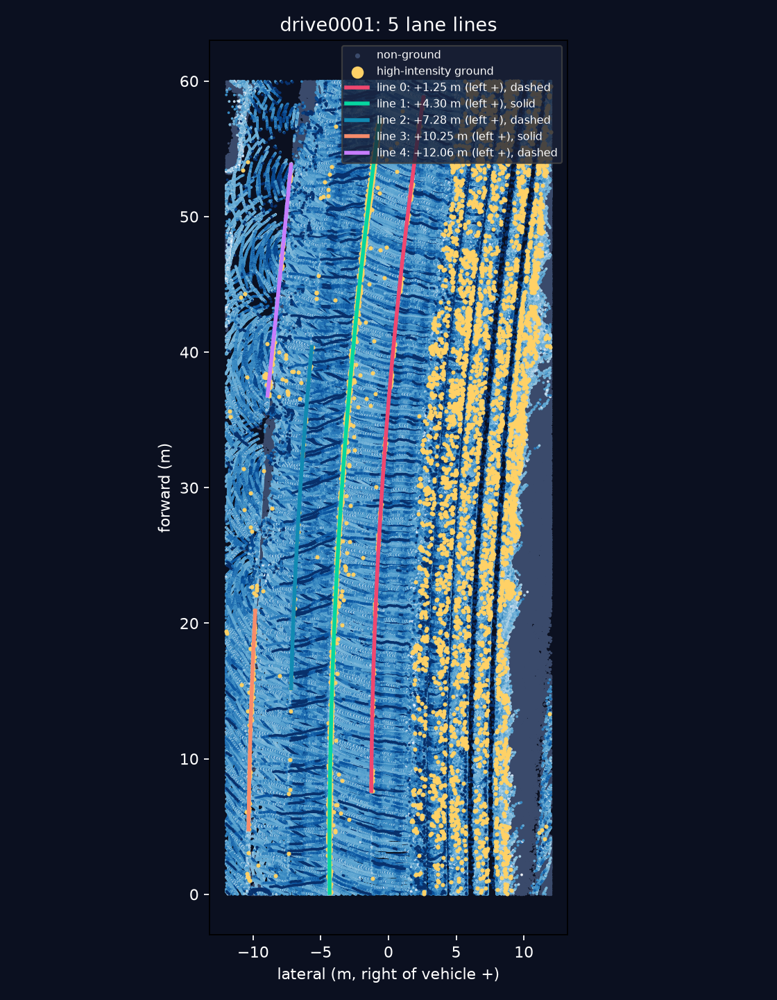

# LiDAR lane-marking extraction

Turning raw LiDAR road scans into lane-line geometry, the first step of an HD map.

Lane paint is retroreflective, so it returns noticeably higher intensity than asphalt.
This pipeline finds the road surface, picks out paint by intensity, and fits lane lines.
It uses classical geometry and no neural network, so every step can be inspected.

**Real data: KITTI raw drive `2011_09_26_drive_0001`, 40 stitched scans (~4.5M points)**



**Simulated 3-lane road with known ground truth**


## Pipeline

1. **Stitch scans** (`accumulate.py`): a single scan is too sparse along the road, so consecutive scans are merged into one local map using the GPS/IMU poses.
2. **Ground plane**: RANSAC restricted to near-horizontal planes, then a least-squares refit on the inliers.
3. **Paint candidates**: a range-adaptive intensity threshold (median + k·MAD per 2 m range bin).
4. **Structure filter**: drops bright ground points that have a pole, kerb or vehicle directly above them.
5. **Anisotropic DBSCAN**: the x axis is compressed 4×, so paint hits on successive LiDAR rings chain into one segment. The step keeps elongated, longitudinal clusters.
6. **Lane chaining**: each segment joins the lane whose extrapolated trajectory passes closest to it.
7. **Fragment merging**: pieces of the same line that sit end to end and agree laterally are joined.
8. **Quality filter**: drops lines with a fit residual above 0.15 m (kerbs, rails, gravel) or shorter than 8 m.
9. **Fit and classify**: a polynomial y = f(x) per line. Solid vs dashed comes from paint coverage along the line.

## Results

### Real data (KITTI drive 0001, urban road beside tram tracks)

- Recovers the **dashed centre line** (about 51 m long, 4.8 cm fit residual) and a **solid line** 3.05 m away (8.6 cm residual), which is a typical urban lane width.
- **Failure mode found:** tram rails and gravel reflect as brightly as paint, so the intensity step marks them as candidates. Before the quality filter they produced many short, noisy false lines. The residual filter removes most of them, but intensity alone can't separate rails from paint. That needs geometry priors (rail spacing, parallel pairs) or a learned classifier.
- Tuning: `--k-mad 2.5`. A stricter threshold (3.0) fragmented real lines; a looser one (2.0) let in kerbs and pavement.

### Simulation (64-beam LiDAR, 3-lane road, known geometry)

| Setup | Lines found | False positives | Mean lateral error |
|---|---|---|---|
| Single scan, gentle curve | 2/4 | 0 | ~2 cm (dashed lines missed) |
| 20 stitched scans, straight | **4/4** | 0 | < 1 cm |
| 20 stitched scans, gentle curve (R≈250 m) | **4/4** | 0 | < 1 cm |
| 20 stitched scans, tight curve (R≈125 m) | **4/4** | 0 | < 1 cm |

**Key finding:** a single scan misses dashed lines because beam rings are too sparse along the road. Stitching scans recovers them, which is why mapping pipelines accumulate before extracting lanes.

**Caveat:** simulated errors are optimistic because the simulation has perfect poses. On real data, pose drift and LiDAR–IMU calibration error dominate.

## Run

```bash
pip install -r requirements.txt

# Synthetic test with ground truth
python simulate_scan.py --out data/sim.npy --accumulate 20 --curve 0.002
python lane_extract.py data/sim.npy --out results --x-range 3 40
python eval_synthetic.py --pred results/sim_lanes.json --gt data/sim_gt.json

# Real KITTI raw drive (download the synced+rectified drive and the date's calibration
# from cvlibs.net/datasets/kitti; extract both into kitti/)
python accumulate.py --base kitti --date 2011_09_26 --drive 0001 --n 40 --step 2 --out data/drive0001.npy
python lane_extract.py data/drive0001.npy --x-range 0 60
```

## Next steps

- Align the map to the road heading before fitting, so lanes run straight up the plot.
- Reject rail pairs using their fixed gauge (~1.435 m apart, always paired).
- Remove moving vehicles before stitching.
- Score against a labelled HD map instead of simulation.

## Files

- `accumulate.py`: stitches KITTI raw scans into one local map using the GPS/IMU poses (via pykitti).
- `lane_extract.py`: the pipeline. It writes a BEV PNG and a JSON report.
- `simulate_scan.py`: a 64-beam LiDAR simulator with intensity falloff, noise, curves, stopped cars and poles.
- `eval_synthetic.py`: lane recall, false positives and lateral error against ground truth.
